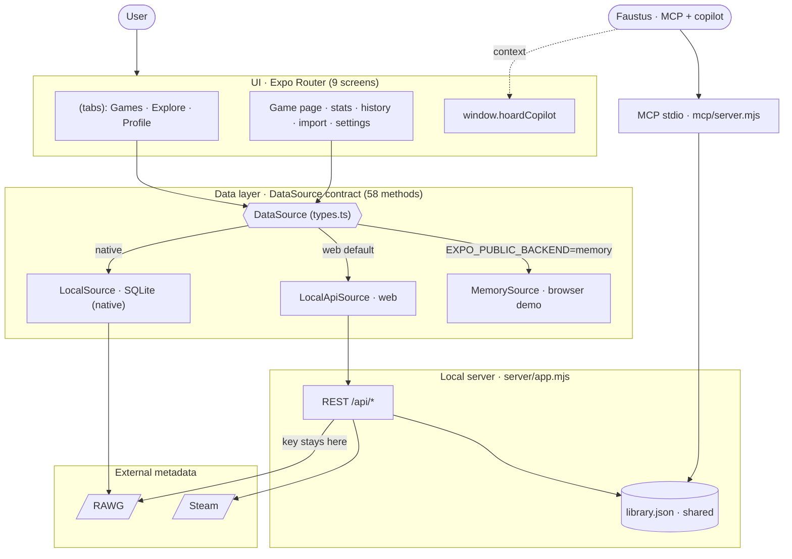

# GamerHoard — Living Knowledge Graph

> Auto-generated map of the codebase. Regenerate with `node docs/knowledge-graph/generate.mjs`.
> Last generated: **2026-10-12T04:22:16.289Z**

Open **`graph.html`** in a browser for the interactive, clickable version. This file is the readable companion.

## What this app is (60-second orientation)

GamerHoard is a **local, single-user video-game library**: a web app served by `server/index.mjs` (port 5207), MCP tools for Faustus and an optional native Expo app, all over ONE library file (`~/.gamerhoard/library.json`). No accounts, no cloud. You build a library of games, track their state (**Pendiente · Jugando · Pausado · Completado · Abandonado**), tick off **DLCs/expansions**, log **play sessions**, mark which **platforms** you own each game on, rate them and keep private notes. Metadata comes from **RAWG** (through the local server, which keeps the key); the hero import is your **Steam** library (owned games + playtime).

**Inherited names, new meaning (read this or you WILL be confused):** the client keeps an older tracker's schema names to minimise churn. A **`show` / `tvdb_id` is a GAME** (RAWG id; Steam games use `2_000_000_000 + appid`; manual games `1_000_000_000 + hash`), an **`episode` is a DLC/expansion**, **`network` is the studio/publisher**, and the `movie*` methods are legacy stubs. `src/tmdb.ts` is a shim that re-exports `src/rawg.ts`.

**The one abstraction that matters:** every screen talks to a single `DataSource` interface (`apps/mobile/src/db/types.ts`, 58 methods). Three interchangeable implementations satisfy it — `LocalApiSource` (REST to the local server, web default), `LocalSource` (SQLite, native), `MemorySource` (browser demo). The active one is chosen at load time in `src/db/index.ts` (native) / `index.web.ts` (web). **If you add a data operation, you implement it in all three** (stubs are fine for features that do not apply to games).

## At a glance

| Metric | Count |
| --- | --- |
| Screens (routes) | 9 |
| Layouts / special files | 4 |
| Source modules | 38 |
| DataSource methods | 58 |
| External APIs | 4 |
| Languages (i18n) | 2 (176 keys) |
| Graph nodes / edges | 57 / 127 |

## Architecture

## Screens (Expo Router)

File-based routing under `apps/mobile/app/`. `(tabs)` is a layout group (not part of the URL). 

| Route | File | What it is |
| --- | --- | --- |
| `/` | `(tabs)/index.tsx` |  |
| `/explore` | `(tabs)/explore.tsx` |  |
| `/history` | `history.tsx` |  |
| `/import` | `import.tsx` |  |
| `/language` | `language.tsx` |  |
| `/profile` | `(tabs)/profile.tsx` |  |
| `/settings` | `settings.tsx` |  |
| `/show/[id]` | `show/[id].tsx` |  |
| `/stats` | `stats.tsx` |  |

## Source modules by area

### Data layer (`src/db/`) — the DataSource contract + backends

| Module | Purpose |
| --- | --- |
| `db/index.ts` | Native (iOS/Android) data source: on-device SQLite. |
| `db/index.web.ts` | Web data source. Never imports ./local (keeps expo-sqlite out of the web bundle). localapi (default) -> the local server and the shared library memory -> browser-only demo data |
| `db/local.ts` |  |
| `db/localapi.ts` | Local web data source: the browser talks to server/index.mjs, which reads and writes the same library file as the Faustus MCP tools (~/.gamerhoard/library.json). |
| `db/localapiMap.ts` | Pure mapping between the library JSON served by server/index.mjs and the rows the screens use. |
| `db/memory.ts` | Web / SSR fallback: same DataSource contract, backed by the seed JSON held in memory. |
| `db/schema.ts` | Local (on-device) SQLite schema used by the native app (see ./index.ts). |
| `db/types.ts` |  |

### Feature logic (`src/*.ts`) — RAWG, Steam, copilot, ratings, stats…

| Module | Purpose |
| --- | --- |
| `categories.ts` |  |
| `copilot.ts` |  |
| `copilotContext.ts` | Pure context builders for the Faustus copilot (window.hoardCopilot.context). |
| `copilotRegistry.ts` |  |
| `data.ts` | Domain types (mirror the Postgres schema) + demo data. |
| `dates.ts` | Date-only helpers with LOCAL-day semantics. |
| `export.ts` |  |
| `genres.ts` | Library genre support: id<->name maps (localized) + lazy TMDB backfill of the `genres` column (comma-joined TMDB genre ids; '' = resolved but none/unknown). |
| `img.ts` | Placeholder poster while the real TMDB artwork loads/backfills: a neutral dark tile with the title's initial. |
| `posterSweep.ts` | One-shot bulk poster/genre resolver for freshly imported libraries. |
| `pwa.ts` | PWA install support. The `beforeinstallprompt` event fires ONCE early in the page life (Chromium only), so this module is imported for its side effect from _layout and stashes the event for the Set… |
| `ratings.ts` | External ratings, visible in the app (not just links). |
| `rawg.ts` | GamerHoard game-metadata client — reads from the RAWG Video Games Database (https://rawg.io/apidocs). |
| `statsCard.ts` | Shareable stats card — renders a branded 1080x1350 PNG on an offscreen canvas (web only) and hands it to the Web Share API, falling back to a download. |
| `steam.ts` | Steam import for the local app. |
| `theme.ts` | GamerHoard design tokens — dark, cover-forward, cyan + violet accents (gaming vibe). |
| `tmdb.ts` | Compatibility shim. GamerHoard reads game data from RAWG; the real implementation lives in ./rawg.ts. This file keeps the historical import path (`../src/tmdb`) working so screens that haven't been… |
| `useData.ts` |  |

### UI components (`src/*.tsx`)

| Module | Purpose |
| --- | --- |
| `components.tsx` |  |
| `detail.tsx` | Shared building blocks for the game-detail screen (GamerHoard). |
| `DragScrollView.tsx` |  |
| `Fireworks.tsx` |  |
| `GameActionsModal.tsx` |  |
| `NextGameModal.tsx` |  |
| `SessionsCard.tsx` |  |
| `Skeleton.tsx` |  |

### Low-level libs (`src/lib/`)

| Module | Purpose |
| --- | --- |
| `lib/backend.ts` | Single source of truth for which DataSource is active. |

### Internationalization (`src/i18n/`)

| Module | Purpose |
| --- | --- |
| `i18n/en.ts` | English translations (default language). |
| `i18n/es.ts` | Spanish translations. Typed as `Dict` (the shape of en.ts) so tsc flags any missing OR extra key versus English — this is our "nothing left behind" guard. |
| `i18n/index.ts` | i18next setup for GamerHoard. |

## The data contract (`DataSource`)

Every method must exist in all three backends. Coverage below is auto-checked against `local.ts` / `localapi.ts` / `memory.ts`. A `—` means the method looks missing in that backend — usually a bug or a deliberate no-op worth confirming.

Entity/row types: `Profile`, `ShowRow`, `RecentRow`, `GameSession`, `MovieRow`, `ReviewRow`, `BadgeRow`, `ListRow`, `ListItemRow`, `AddShow`, `AddMovie`, `SteamGame`.

**Lifecycle & import**

| Method | Local | LocalApi | Memory |
| --- | --- | --- | --- |
| `ready` | ✅ | ✅ | ✅ |
| `clearData` | ✅ | ✅ | ✅ |
| `reimport` | ✅ | ✅ | ✅ |
| `importData` | ✅ | ✅ | ✅ |

**Reads — library**

| Method | Local | LocalApi | Memory |
| --- | --- | --- | --- |
| `getProfile` | ✅ | ✅ | ✅ |
| `getContinueWatching` | ✅ | ✅ | ✅ |
| `getShows` | ✅ | ✅ | ✅ |
| `getShowById` | ✅ | ✅ | ✅ |
| `getMovies` | ✅ | ✅ | ✅ |
| `getUpcomingMovies` | ✅ | ✅ | ✅ |
| `getMovieByUuid` | ✅ | ✅ | ✅ |
| `getReviews` | ✅ | ✅ | ✅ |
| `getBadges` | ✅ | ✅ | ✅ |
| `getFavorites` | ✅ | ✅ | ✅ |
| `getFavoriteMovies` | ✅ | ✅ | ✅ |
| `getRecent` | ✅ | ✅ | ✅ |

**Lists**

| Method | Local | LocalApi | Memory |
| --- | --- | --- | --- |
| `getLists` | ✅ | ✅ | ✅ |
| `getListById` | ✅ | ✅ | ✅ |
| `getListItems` | ✅ | ✅ | ✅ |
| `createList` | ✅ | ✅ | ✅ |
| `renameList` | ✅ | ✅ | ✅ |
| `deleteList` | ✅ | ✅ | ✅ |
| `addToList` | ✅ | ✅ | ✅ |
| `removeFromList` | ✅ | ✅ | ✅ |

**Play state & progress (game / DLCs)**

| Method | Local | LocalApi | Memory |
| --- | --- | --- | --- |
| `logRecent` | ✅ | ✅ | ✅ |
| `setShowState` | ✅ | ✅ | ✅ |
| `markWatched` | ✅ | ✅ | ✅ |
| `setProgress` | ✅ | ✅ | ✅ |
| `getWatchedEpisodes` | ✅ | ✅ | ✅ |
| `seedEpState` | ✅ | ✅ | ✅ |
| `setEpisodeWatched` | ✅ | ✅ | ✅ |
| `setShowNextAir` | ✅ | ✅ | ✅ |

**Replay**

| Method | Local | LocalApi | Memory |
| --- | --- | --- | --- |
| `rewatchMovie` | ✅ | ✅ | ✅ |
| `rewatchEpisode` | ✅ | ✅ | ✅ |
| `getEpisodeRewatches` | ✅ | ✅ | ✅ |

**Library membership**

| Method | Local | LocalApi | Memory |
| --- | --- | --- | --- |
| `addShow` | ✅ | ✅ | ✅ |
| `addMovie` | ✅ | ✅ | ✅ |
| `setMovieWatched` | ✅ | ✅ | ✅ |
| `removeShow` | ✅ | ✅ | ✅ |
| `removeMovie` | ✅ | ✅ | ✅ |
| `isShowInLibrary` | ✅ | ✅ | ✅ |
| `isMovieInLibrary` | ✅ | ✅ | ✅ |

**Metadata & posters**

| Method | Local | LocalApi | Memory |
| --- | --- | --- | --- |
| `setShowMeta` | ✅ | ✅ | ✅ |
| `setShowPoster` | ✅ | ✅ | ✅ |
| `setShowGenres` | ✅ | ✅ | ✅ |
| `setMoviePoster` | ✅ | ✅ | ✅ |
| `setMovieGenres` | ✅ | ✅ | ✅ |
| `setMovieReleaseDate` | ✅ | ✅ | ✅ |
| `setMovieTmdbId` | ✅ | ✅ | ✅ |
| `getUncheckedPendientes` | ✅ | ✅ | ✅ |
| `markMovieChecked` | ✅ | ✅ | ✅ |

**Games — platforms · Steam · rating · notes**

| Method | Local | LocalApi | Memory |
| --- | --- | --- | --- |
| `setOwnedPlatforms` | ✅ | ✅ | ✅ |
| `setPlatforms` | ✅ | ✅ | ✅ |
| `addSteamGame` | ✅ | ✅ | ✅ |
| `setShowRating` | ✅ | ✅ | ✅ |
| `setShowNotes` | ✅ | ✅ | ✅ |

**Favorites**

| Method | Local | LocalApi | Memory |
| --- | --- | --- | --- |
| `setShowFavorite` | ✅ | ✅ | ✅ |
| `setMovieFavorite` | ✅ | ✅ | ✅ |

## External APIs

| API | Host | Key? | Used by (modules) | Purpose |
| --- | --- | --- | --- | --- |
| RAWG | `api.rawg.io` | key | `rawg.ts` | Primary game metadata: games, DLCs, genres, platforms, stores (where to play), Metacritic, screenshots, similar. Free key. Cached (mem + disk, 24h). |
| Steam | `steampowered.com` | key | `import.tsx`, `steam.ts` | Library import (owned games + playtime). Web: the local server makes the calls (no CORS in the browser); native: direct. The Web API key is typed per import and never written to the library file. Also store links + CDN header images. |
| Local server (REST) | `127.0.0.1:5207` | keyless | `copilot.ts`, `db/localapi.ts`, `db/localapiMap.ts`, `export.ts`, `rawg.ts`, `steam.ts` | server/app.mjs: REST over the shared library file (same file as the MCP tools), RAWG proxy that keeps the key server-side, Steam import, Faustus copilot relay. |
| TMDB (legacy) | `image.tmdb.org` | key |  | Vestigial from the original tracker. src/tmdb.ts is a shim re-exporting rawg.ts. |

## i18n & configuration

Languages: en (176 keys), es (176 keys). Default English; EN is the source of truth — other locales are typed against it so `tsc` catches missing keys. Add strings in `src/i18n/{en,es}.ts` and reference them with the t() helper.

Environment variables (names only; see `.env.example`): `EXPO_PUBLIC_BACKEND`, `EXPO_PUBLIC_RAWG_KEY`.

## Change recipes — "where do I edit X?"

**Add a new data operation (e.g. a new user action that persists):**
1. Add the method signature to the `DataSource` interface in `src/db/types.ts`.
2. Implement it in **all three** backends: `src/db/localapi.ts` (REST), `src/db/local.ts` (SQLite), `src/db/memory.ts` (browser demo). For the REST one, add the route in `server/app.mjs` and, if it needs new library fields, in `mcp/library.mjs` (the MCP tools share it).
3. Call it from the screen. The coverage table above should show ✅✅✅ after — re-run the generator to confirm.

**Add a new screen:** create `apps/mobile/app/<route>.tsx` (or `app/<group>/[param].tsx` for dynamic). Expo Router picks it up by filename. Add nav from wherever it should be reachable, add its strings to i18n (EN first, `es.ts` is typed against it) and, if it has a list or a form, register it with `useCopilotView` and extend `src/copilotContext.ts` + its test so Faustus sees it.

**Add a language:** create `src/i18n/<code>.ts` typed as the EN dict, register it in `src/i18n/index.ts` (`LANGS`, `resources`, `addResourceBundle`), and it shows up in the language picker.

**Add / change game metadata (RAWG):** work in `src/rawg.ts` (cached, deduped; on web it goes through `/api/rawg`). It keeps the old export names (`showDetails`, `detailsById`, …) so screens keep compiling. If you add a new fetched host, register it in `API_SIGNS` of `generate.mjs`.

**Touch the Steam import:** screen `app/import.tsx`, client `src/steam.ts` (`importSteam`), server route `POST /api/steam/import`, shared logic `mcp/integrations.mjs`. Never put a Steam key in the bundle or the library file. Owned games get `tvdb_id = STEAM_ID_OFFSET + appid`.

**Change what Faustus sees:** `src/copilotContext.ts` (pure builders, tested in `copilotContext.test.mjs`), screens register with `useCopilotView`, `src/copilot.ts` installs `window.hoardCopilot`. Keep `x-family.copilot.context` in `faustus-plugin.json` in sync.

## Gotchas & landmines

- **Inherited names, new semantics.** `show`/`tvdb_id` = **game**, `episode`/`ep_state` = **DLC**, `network` = **studio/publisher**; `movie*` methods are stubs. `src/tmdb.ts` re-exports `src/rawg.ts`. Grep results for "show"/"episode" are almost always about games/DLCs.
- **Three backends, one contract.** Forgetting one of `local`/`localapi`/`memory` is the most common bug. The coverage table catches it.
- **One library file, two processes.** Only `mcp/library.mjs` touches `library.json`; the server and the MCP process re-read it when the file changes. Library states (`playing`, `paused`, `completed`) map to UI states (`watching`, `stopped`, `archived`) in `db/localapiMap.ts`.
- **Steam IDs are offset.** A Steam-imported game's id is `STEAM_ID_OFFSET (2_000_000_000) + appid`; manual games use `1_000_000_000 + hash`. Ids from 1e9 up have no RAWG record, so `rawg.ts` skips the request. Use `isSteamId` / `appidOf` from `src/steam.ts`.
- **Web vs native split:** `src/db/index.ts` (native, SQLite) vs `src/db/index.web.ts` (web) keep `expo-sqlite` out of the web bundle. Never import `./local` from web code.
- **Build needs a real `node_modules`** next to the repo root: a junction to another checkout makes `expo export` write asset paths outside `dist`.
- **Secrets live in `.env` / the server environment (gitignored), never the repo.** `RAWG_API_KEY` for the server, `EXPO_PUBLIC_RAWG_KEY` only for native builds.

## Curated notes

<!-- Hand-maintained. Edit CURATED.md; the generator injects it here verbatim. -->

> Hand-maintained durable knowledge that the generator can't read from code.
> Edit this file freely; `generate.mjs` injects it verbatim into `MAP.md`.

### North star & positioning
GamerHoard is a **local, single-user video-game library**. One JSON file (`~/.gamerhoard/library.json`) is shared by a web app (served by `server/index.mjs`), the Faustus MCP tools (`mcp/server.mjs`) and, separately, a native Expo app with its own SQLite. No accounts, no cloud, no public site. Metadata comes from **RAWG**; the hero import is your **Steam** library. User docs: `README.md` / `README.es.md`; REST and copilot routes: `docs/API.md`; product tour (Spanish): `GAMERHOARD.md`.

### Inherited names, new semantics — the thing that trips everyone up
The client began as an older series tracker and **kept its schema/method names** with game meaning. Internalise this map or every grep result will mislead you:

| Code name | Actually means |
| --- | --- |
| `show` / `ShowRow` / `tvdb_id` | **a game** (id = RAWG id; Steam games `2_000_000_000 + appid`; manual games `1_000_000_000 + hash`) |
| `episode` / `ep_state` / `watched_episodes` | **a DLC / expansion** (same checklist UI) |
| `network` | **studio / publisher** |
| `season` | **DLC group** |
| "where to watch" | **where to play** (stores: Steam, PSN, Xbox, GOG…) |
| TMDB rating | **Metacritic** (+ link-outs to OpenCritic, HowLongToBeat…) |
| `movie*` methods | **legacy stubs**; the web data source returns empty lists |
| `src/tmdb.ts` | a **shim** that re-exports `src/rawg.ts` so old imports keep compiling |

### Runtime modes
- **Web (default)** → `LocalApiSource` (`src/db/localapi.ts`): the browser talks to the local server, which reads and writes the shared library file. `EXPO_PUBLIC_BACKEND=memory` gives a browser-only demo.
- **Native** → `LocalSource` (SQLite on the device, seeded from `assets/seed.json`, created empty from `seed.sample.json` by `scripts/ensure-seed.js`). It does **not** read the computer's library file.
- There is no cloud backend and no login. `app.config.js` carries no keys; the RAWG key comes from the server environment (web) or `EXPO_PUBLIC_RAWG_KEY` (native builds).

### Game states
Library states `backlog | playing | paused | completed | dropped` ↔ UI states `backlog | watching | stopped | archived | dropped` (`db/localapiMap.ts`); `src/categories.ts` maps UI states to the buckets (Pendiente, Jugando, Pausado, Completado, Abandonado). DLC completion drives the progress bar. DLC are stored by title in the library; the optional `number` keeps the RAWG catalogue position so the checklist matches DLC marked through Faustus.

### Steam import — the must-knows
- Screen `app/import.tsx` → `importSteam(profile, key)` in `src/steam.ts` → web: `POST /api/steam/import` (the server calls Steam, no CORS problem); native: direct Steam Web API calls.
- The profile can be a SteamID64, a profile URL or a vanity name. The Web API key is typed by the user, remembered only in AsyncStorage/localStorage and never written to the library file or logs. Needs the profile's "Game details" set to Public.
- **ID offset:** a Steam game's id = `STEAM_ID_OFFSET (2_000_000_000) + appid`. Use `isSteamId` / `appidOf`.
- **State from playtime:** never played → `backlog`; played in the last 90 days → `playing`; older → `paused`.
- Achievements: MCP tools and `GET /api/games/:id/achievements`; no UI.

### RAWG client (`src/rawg.ts`)
Read-only, in-flight deduped, two-tier cache (memory → AsyncStorage/IndexedDB, 24h TTL), 12s timeout. Web calls go to `/api/rawg/*` (server adds the key; allow-listed paths only); native calls `https://api.rawg.io/api` with `EXPO_PUBLIC_RAWG_KEY`. Ids from 1e9 up have no RAWG record and are never requested. Keeps the old TMDB export names on purpose.

### Faustus copilot
`window.hoardCopilot` (`src/copilot.ts`) is installed from the root layout (web only). Pure builders live in `src/copilotContext.ts`; mounted screens register what they show (visible games, unsaved form fields) with `useCopilotView` (`src/copilotRegistry.ts`). `onTurnEnd` and `hoard:copilot-turn-end` call `refreshAllQueries()` (debounced) so lists refresh without remounting forms. The launcher, the relay routes and the injection come from `server/hoard-commons` (vendored family helpers).

### Landmines
- **Three backends, one contract.** Any `DataSource` method must exist in `local.ts`, `localapi.ts` and `memory.ts`. The coverage table in `MAP.md` catches a miss.
- **One library file, two processes.** Only `mcp/library.mjs` touches it; both processes re-read it when mtime/size changes. REST calls are serialised.
- **Web vs native split.** `src/db/index.ts` vs `src/db/index.web.ts` keep `expo-sqlite` out of the web bundle. Never import `./local` from web code.
- **Real `node_modules` for the web build.** A junction to another checkout makes `expo export` write asset paths outside `dist`.
- **Never commit** `.env`, keystores or `assets/seed.json` (personal data).

## Migración a Expo SDK 56 (2026-07-24) — target API 36 de Play

Play exige targetSdk 36 (Android 16) desde el 2026-08-31. GamerHoard saltó de SDK 52 a
**SDK 56** (RN 0.85, React 19.2, **Nueva Arquitectura obligatoria** — la legacy se eliminó
en SDK 55). Nota: WatchHoard quedó en SDK 54 (rama `expo-sdk54-api36`), así que los
gemelos divergen de SDK a partir de aquí.

Qué cambió (receta = la de bookhoard-v2 del mismo día):

- `app.json`: fuera `newArchEnabled` (ya no existe); el splash top-level pasó al plugin
  `expo-splash-screen` con `image` (obligatoria en SDK 56 — sin ella el build de Android
  falla con `resource drawable/splashscreen_logo not found`).
- `package.json`: deps alineadas con `npx expo install --fix`; TS `~6.0.3` +
  `@types/react ~19.2`; `react-native-reanimated@4.3.1` y `react-native-worklets@0.8.3`
  **pineados como deps directas** (los arrastra expo-router 56 con peer `*`; sin pin, npm
  coge worklets 0.11 que expo-modules-core marca invalid). `intl-pluralrules` añadido e
  importado como PRIMERA línea de `src/i18n/index.ts` (Hermes no trae Intl.PluralRules;
  sin él, las claves `_one/_other` renderizan crudas en Android — bug ya pagado en BookHoard).
- Lockfile **regenerado entero** (node_modules raíz+workspaces y package-lock borrados):
  el lock viejo dejaba módulos nativos duplicados (react 18/19, RN 0.76/0.85) — si
  expo-doctor acusa "duplicate native modules", esa es la cura.
- FlashList v2 (new-arch only): `estimatedItemSize` eliminado (8 usos en 6 archivos).
- `StyleSheet.absoluteFillObject` ya no existe en RN 0.85 → `...StyleSheet.absoluteFill`
  (account, person/[id], u/[handle]).
- Edge-to-edge obligatorio: tab bar con `height: 84 + insets.bottom` + `paddingBottom`
  en `app/(tabs)/_layout.tsx`.
- `tsconfig.json` sin `baseUrl` (deprecado en TS 6).
- **`apps/mobile/scripts/shorten-cxx.init.gradle`** (nuevo): al compilar Android, pasar
  `-I ..\scripts\shorten-cxx.init.gradle` a gradlew — mueve los `.cxx` de CMake a
  `C:\_cxx\gh\<módulo>` porque los .o replican la ruta absoluta del repo y revientan
  MAX_PATH 260 (síntoma: `ninja: manifest 'build.ninja' still dirty after 100 tries`,
  visto con react-native-worklets en bookhoard-v2). NO usar unidades `subst` como
  atajo: el codegen de RN hace `fs.realpath` y muere con "different roots".
- Avisos de expo-doctor que quedan y son esperables: (1) "app.json + app.config.js" —
  falso positivo, `app.config.js` hace spread de `appJson.expo`; (2) metro
  `disableHierarchicalLookup` — override intencional del monorepo.

Verificado: `tsc --noEmit` ✓ (con canary), `npx expo export --platform web` ✓, expo-doctor
19/21 (los 2 de arriba), knowledge graph regenerado. Pendiente (humano): build Android
release + prueba en device (edge-to-edge, Steam import, SQLite local backend en la
nueva arquitectura) y subida a Play cuando toque.

---

_This map is generated. Don't edit it by hand — edit `CURATED.md` for durable notes, or the code itself, then run `node docs/knowledge-graph/generate.mjs`._
